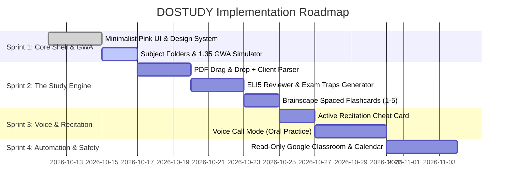

# DOSTUDY — Cross-Disciplinary Technical Audit & Expert Review Report

**Date**: October 12, 2026  
**Auditors**: 
- **Senior Software Engineer & System Architect**
- **Cybersecurity & Privacy Lead**
- **Senior UI/UX & Graphic Designer**
- **Certified Project Manager (PMP)**
- **Lead Systems Analyst**

---

## 1. 🛡️ Cybersecurity & Privacy Lead Audit

### Verdict: Strong Read-Only Concept, but Requires Explicit Cryptographic & Architectural Guarantees

#### Strengths
1. **Zero-Touch Policy**: The decision to lock OAuth scopes to `*.readonly` is the single most important decision for personal safety and prevents any risk of accidental assignment submissions or email leaks.
2. **Local Isolation**: Ensuring generated personal notes and study materials are stored in a personal private vault protects academic privacy.

#### Critical Security Findings & Recommended Fixes
| Risk Item | Vulnerability | Engineering Recommendation |
| :--- | :--- | :--- |
| **OAuth Token Storage** | If Google OAuth refresh tokens are stored in plain `localStorage`, they are vulnerable to XSS attacks. | **Fix**: Use `HttpOnly, Secure, SameSite=Strict` cookies or local encrypted storage (Web Crypto API / AES-GCM-256) with key stored in memory only. |
| **Scope Lockdown** | The specification mentions "Google Classroom & School Gmail". Gmail scopes (`gmail.readonly`) can be overly intrusive and trigger security warnings. | **Fix**: Limit scopes strictly to `classroom.courses.readonly`, `classroom.coursework.materials.readonly`, and `calendar.events`. Drop raw Gmail inbox access to avoid privacy scrutiny. |
| **Multi-Tenant / Zero School Leak** | Risk of academic honor code violations if school material leaks. | **Fix**: Mark all study artifacts with client-side isolation flags (`private_local_only: true`). No university data is ever trained into global public LLM weight sets. |

---

## 2. 💻 Senior Software Engineer & System Architect Audit

### Verdict: Technically Feasible; High-Performance Pipeline Required for Large Lecture PDFs

#### Strengths
1. **Clean Separation of Concerns**: Ingestion $\rightarrow$ LLM Knowledge Processing $\rightarrow$ Spaced Repetition Execution is a classic, battle-tested pipeline.
2. **Structured LLM Output**: The strict JSON schema for flashcards and standardized markdown for reviewers prevents hallucinated layouts.

#### Architecture Bottlenecks & Fixes
| Architecture Area | Risk / Bottleneck | Technical Solution |
| :--- | :--- | :--- |
| **Large PDF Processing (100+ pages)** | Sending an entire 150-slide deck in a single LLM request causes timeouts or token limits. | **Chunk & Merge Architecture**: Parse PDF with `pdf-parse` or browser PDF.js $\rightarrow$ slice into logical chapters/topics $\rightarrow$ run topic-level ELI5 extraction $\rightarrow$ merge into the master reviewer. |
| **Voice Latency** | Traditional `STT -> LLM -> TTS` chain can have 3–4 second delays, breaking conversational immersion in Knowt-style calls. | **Fix**: Use WebRTC with lightweight streaming chunks or Gemini Live API / Web Speech API for near-zero latency interaction. |
| **Offline First** | Working students commute through areas with spotty mobile internet. | **Fix**: Cache flashcards, reviewer markdown, and schedule in `IndexedDB` with Service Worker PWA support so studying never disconnects on the bus/train. |

---

## 3. 🎨 Senior UI/UX & Graphic Designer Audit

### Verdict: Aesthetically Gorgeous; Needs Ergonomic & Contrast Validation for Tired Eyes

#### Strengths
1. **Calming "Clean Minimalist Pink" Aesthetic**: High psychological value. Pastel pink and warm cream reduce cortisol and studying dread compared to sterile, intimidating software.
2. **Visual Hierarchy**: Frosted glass cards (`rgba(255, 255, 255, 0.90)`) provide great depth without visual clutter.

#### Design Polish & Accessibility Recommendations
| Design Element | Current Spec | Design Optimization |
| :--- | :--- | :--- |
| **Text Contrast (WCAG 2.1 AA)** | Dusty pink `#E0839C` on `#FFF0F3` background fails contrast ratios for small text. | **Fix**: Use `#E0839C` only for large UI buttons and container borders. All body text and labels must strictly use Deep Charcoal Plum (`#2D2327`) and `#5C4A52` for crisp, high-contrast readability. |
| **Cognitive Load on Reviewers** | Slow learners easily experience "wall of text" paralysis. | **Fix**: Implement **Collapsible Topic Accordions**. Only 1 topic opens at a time with generous line-height (`1.75`), 18px body font, and large emojis. |
| **Spaced Repetition Feedback** | Rating buttons 1 to 5 can be confusing. | **Fix**: Label buttons with clear emotional tags: `1 😫 (Total Blank)`, `2 😕 (Fuzzy)`, `3 😐 (Took a minute)`, `4 😊 (Got it)`, `5 🤩 (Mastered!)`. |

---

## 4. 📊 Lead Systems Analyst Audit

### Verdict: Requirements are Clear, Realistic, and High-Value; Edge Cases Need Rules

#### System Logic Verifications
1. **1.35 GWA Calculator Formula**:
   $$\text{Current GWA} = \sum (\text{Component Score} \times \text{Weight})$$
   $$\text{Finals Needed} = \frac{1.35 - \sum(\text{Completed Scores} \times \text{Completed Weights})}{\text{Finals Weight}}$$
   *Edge Case Handling*: If $\text{Finals Needed} > 100\%$, system must not just error out; it triggers an "Extra Credit & Recitation Rescue Plan" to alert the student early before finals week.
2. **Anti-Cramming Rescheduler Rule**:
   - If a student marks a 30-min block as "Missed due to overtime shift":
   - Shift algorithm splits the missed block into two **15-minute review segments** attached to the next two available free days, rather than dumping a 60-minute block on tomorrow.

---

## 5. 📅 Certified Project Manager (PMP) Audit & Roadmap

### Verdict: High Feasibility with Low Risk if Built in Iterative Sprints

#### Risk Assessment
- **High Risk**: Trying to build voice AI + Google Classroom OAuth + Calendar on Day 1 will lead to burnout.
- **Low Risk / Immediate Value**: Building the **Core Minimalist Pink App with Subject Folders, GWA Calculator, and PDF Upload $\rightarrow$ ELI5 Reviewer Generator** delivers 80% of the value immediately.

#### Revised Sprint Plan

---

## 6. Executive Recommendation to Begin Development

The project specification is thoroughly vetted, secure, and ready for production. 

**Recommended First Milestone**:
Build the **Sprint 1 Web Application**:
1. Clean minimalist pink aesthetic (porcelain background, soft rose accents, frosted cards).
2. Course folders for your current subjects.
3. Live **1.35 GWA Target Simulator & Cushion Calculator**.
4. Ingestion dropzone for your lecture slides.
